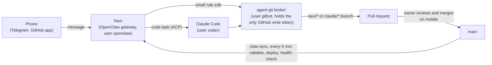

# claw

Configuration, rules and host infrastructure for **Navi**, a personal AI assistant that runs [OpenClaw](https://www.npmjs.com/package/openclaw) on a small VPS, talks over Telegram, and changes itself only through pull requests its owner approves from a phone.

> A personal setup shared as-is, not a supported product. Read it, borrow from it, fork it; just don't expect support. It's opinionated about one person, one droplet, one assistant.

## How it works



Agents never push to `main` or merge. Config changes go live about 5 minutes after a merge: `claw-sync` validates `openclaw.json`, restarts the gateway, and rolls back if it doesn't come up healthy. Host plumbing (`infra/`) is never auto-deployed. The owner applies it with `sudo claw-install`.

This repo is the shared part. The owner's private config repo pulls from it through `upstream-sync/*` PRs and adds the personal files (persona, install-specific rules, private skills). Changes to shared files are made here first.

## Repository layout
- **`openclaw.json`**: OpenClaw configuration (models, channels, plugins, hooks, agent defaults). Personal values come from `.env` via `${VAR}` references.
- **`workspace/`**: the agent's rules.
  - `AGENTS.md`: operating rules: memory, to-dos, the daily briefing, how to change itself, coding hand-off, GitHub issues. Shared, so no personal details.
  - `local/AGENTS.md.example`: template for the private, per-install rules file (schedule, calendar, labels, upstream repo). The real `local/AGENTS.md` is injected right after `AGENTS.md` by OpenClaw's `bootstrap-extra-files` hook.
  - `skills/` (private repo only): private skills, the default home for new ones.
- **`skills/`**: public skills, loaded by OpenClaw as managed skills from `~/.openclaw/skills`.
- **`infra/`**: host scripts and systemd units (`claw-sync`, `claw-backup`, `claw-install`, `coder-acp`, `status.sh`, `gateway-dropins/`) and the brokers in `infra/brokers/` (`git/` is `agent-git`, `cal/` is `agent-cal`). See [`infra/README.md`](infra/README.md).
- **`.github/workflows/ci.yml`**: config validation, shellcheck, infra tests, secret scan, state-file guard.

## Security model
Each job runs as its own Linux user, and secrets live with the one user that needs them:

| User | Role | Access & Permissions |
| :--- | :--- | :--- |
| **`drew`** | Owner (the human) | Has `sudo`, manages the droplet, reviews & merges PRs on GitHub, applies infra with `sudo claw-install`. |
| **`openclaw`** | Navi (Main Assistant) | Owns `~/.openclaw`, runs the Gateway and automations. Modifies local memory files directly. Proposes rule/config changes via `agent-git` (`navi/*` branches). |
| **`coder`** | Claude Code (Worker Agent) | Runs isolated under `/srv/work/<repo>` with a read-only GitHub token. Implements code, infra scripts, and complex configs, proposing PRs via `agent-git` (`claude/*` branches). Follows [`infra/coder-CLAUDE.md`](infra/coder-CLAUDE.md). |
| **`gitbot`** | Write Broker | Only user holding a GitHub write token. Invoked via `sudo -u gitbot agent-git`. Pushes only `navi/*` or `claude/*` branches and manages GitHub issues. Never pushes to `main` or merges. Public repos: writes from `coder` only, each checked for secrets and personal strings first. |
| **`calbot`** | Calendar Broker | Only user holding the iCloud app-specific password. Invoked by Navi via `sudo -u calbot agent-cal`: list calendars, read events, create/update/delete single events (no recurring or shared ones), with backups and undo, capped per day. No invitations. |

- **Brokers hold the secrets.** Navi asks `gitbot` (`agent-git`) to push and `calbot` (`agent-cal`) to touch the calendar through fixed `sudo -u` commands with checked arguments. It never sees a token or password.
- **Deploys are read-only for the agent.** `openclaw`'s deploy key can't push, and `claw-sync` (root-owned, on a timer) resets `~/.openclaw` to `origin/main`, so edits made in place are reverted.
- **Root plumbing is human-applied.** `claw-install` is root-owned and installs `infra/` from a root-owned clone after showing the diff.
- **Public repos are guarded.** For a public repo, `agent-git` takes writes from Claude Code only and checks every commit, title, body and comment against a private redaction list and gitleaks before anything is written ([`infra/README.md`](infra/README.md): Public repos).
- **Agent state stays out of git.** `USER.md`, `MEMORY.md`, `memory/` and `DREAMS.md` live only on the host (backed up nightly to a separate private repo by `claw-backup`). CI fails if they're ever tracked.

## Setting it up
[`infra/README.md`](infra/README.md) has the runbook ("Moving to a new host" doubles as a fresh install). In short: an Ubuntu host reachable only over Tailscale, OpenClaw installed as `openclaw`, `~/.openclaw` as a clone of your config repo, then `sudo claw-install` and the secrets it lists.

`~/.openclaw/.env` (never committed):
- `OPENCLAW_GATEWAY_TOKEN`: gateway auth token
- `TELEGRAM_BOT_TOKEN`: from BotFather
- `TELEGRAM_ALLOW_FROM`: your numeric Telegram user ID (DM allowlist and owner-only commands)
- `HEALTHCHECKS_PING_URL`: dead-man alerts for `claw-sync`

Private files to create: `workspace/local/AGENTS.md` (from the `.example`), and `USER.md`, `SOUL.md`, `IDENTITY.md` (OpenClaw creates starters on first run).

### Forking
Some values are this owner's and need changing in a fork:
- GitHub owner `andrewgarmon`: `OWNER` in `infra/brokers/git/agent-git`, `REPO` in `infra/claw-install`, clone URLs in `infra/coder-CLAUDE.md`.
- The admin Linux user `drew`: sudoers rules, `BROKER_USERS_RESERVED` in `infra/lib/broker-install.sh`, the docs.
- Model refs in `openclaw.json` point at an auth profile created by OpenClaw onboarding (`google:setup-…`). Re-run onboarding or edit them.
- `claw-backup` expects a root bundle of your own state repo at `infra/claw-state-root.bundle` (see the comment in `infra/claw-backup`).
- The issue-label allowlist in `agent-git`.

## Operational Details & Drop-ins

- Systemd drop-ins live in `infra/gateway-dropins/` and are installed to `~/.config/systemd/user/openclaw-gateway.service.d/`:
  - `heap.conf`: Overrides ExecStart with `--max-old-space-size=2048`. Check here if the gateway breaks after `openclaw update`.
  - `compile-cache.conf`: Sets `NODE_COMPILE_CACHE` for faster restarts.

## Plugin Pins
OpenClaw keeps plugin install records (and their pins) in its SQLite state database, not in `openclaw.json` (`plugins.installs` was retired). So a pin can't be committed here; set it on the droplet as drew with sudo:

| Plugin | Package | Pinned version |
| :--- | :--- | :--- |
| duckduckgo | `@openclaw/duckduckgo-plugin` | `2026.11.3` |

This is a manual plugin change, so follow `infra/README.md`: stop `claw-sync` first, otherwise it reverts any `openclaw.json` drift the update leaves behind. `openclaw` is only on openclaw's PATH (`~/.npm-global`), so run it through `sudo -iu openclaw`. The new plugin code loads only after a gateway restart.

```bash
sudo systemctl stop claw-sync.timer
sudo -iu openclaw openclaw plugins update @openclaw/duckduckgo-plugin@2026.11.3
sudo -iu openclaw openclaw security audit   # plugins.installs_unpinned_npm_specs should be gone
sudo -u openclaw git -C /home/openclaw/.openclaw status --short   # if openclaw.json changed, PR and merge it before restarting the timer
sudo -u openclaw XDG_RUNTIME_DIR="/run/user/$(id -u openclaw)" systemctl --user restart openclaw-gateway
sudo systemctl start claw-sync.timer
```

`openclaw update` releases pins on official `@openclaw/*` plugins once core is at or past the pinned version. After every core update, check `openclaw security audit` again and re-pin to the version that matches the new core.
